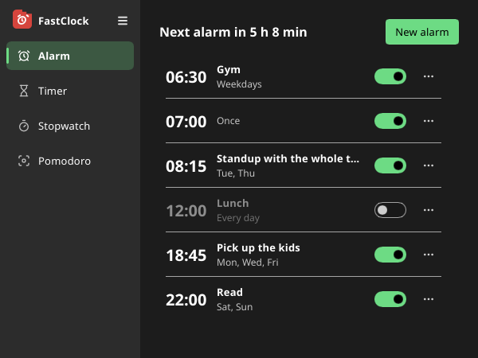

# FastClock

[](https://github.com/evandro777/FastClock/actions/workflows/ci.yml)
[](https://github.com/evandro777/FastClock/actions/workflows/flatpak.yml)
[](https://github.com/evandro777/FastClock/actions/workflows/appimage.yml)
[](https://github.com/evandro777/FastClock/actions/workflows/virustotal.yml)
[](https://www.linux.org/)
[](https://opensource.org/licenses/GPL-3.0)

A light and fast clock for Linux, built with Rust + [Slint](https://slint.dev) (software renderer, no GL): alarms, a timer, a stopwatch and a simple Pomodoro.

Page: <https://evandro777.github.io/FastClock/>



## Features

- **Alarm:** any number of alarms, each with a time, an optional label and the weekdays it repeats on (no day picked rings once, then switches itself off). Alarms ring a sound that loops until you press **Stop** or **Snooze** (5 minutes by default, changeable), or for 5 minutes at most. An alarm still rings if the computer was asleep for up to 3 hours when it was due.
- **Timer:** hours, minutes and seconds; pause, resume and reset. It keeps counting through a suspend and rings on time when the machine wakes.
- **Stopwatch:** start, pause, resume and reset, to a tenth of a second.
- **Pomodoro:** 25 minutes of work and a 5-minute break, four rounds, the fourth break being 15 minutes. A phase end plays the sound once and notifies you; the next phase waits for you to press Start. **Skip** moves to the next phase. The lengths can be changed in `settings.toml` (`work_min`, `short_min`, `long_min`).
- **Desktop notification** for every alarm and timer, with **Snooze** and **Stop** buttons (a click on the notification brings the window up). The same buttons are in the window.
- **Your own sound:** Preferences has **Choose…** (the desktop's file chooser; wav, ogg, flac or mp3), **Test** and **Reset** (back to the built-in bell). A file that cannot be played falls back to the bell, so an alarm is never silent.
- **Keeps ringing in the tray:** closing the window hides it to the tray icon; **Quit** is in the tray menu. Without a tray icon, closing the window quits. Preferences has **Start at login**, which starts it hidden in the tray.
- The preferences dialog also has an Appearance choice (System, Light or Dark) and a Language choice (System, English or Português), both remembered.

Small things that help: the alarm list says when the next alarm rings; a new alarm starts at the next full hour; the timer has 1/5/10/15/30 minute buttons and a thin bar that shrinks as time runs out; the Pomodoro shows a break in green with four dots for the rounds; the window title shows the time left while a timer or Pomodoro runs; an alarm brings the window to the front; **Space** starts and pauses the open page, and **Enter** saves the alarm editor.

Sound needs `paplay` (package `pulseaudio-utils`) or `pw-play` (`pipewire-bin`), which a desktop with PulseAudio or PipeWire already has; the Flatpak includes them.

Not included: laps, alarms that survive a restart while snoozed (Snooze is forgotten if you quit), per-alarm sounds.

## Install

### Flatpak

#### Install from file (no updates)

A `.flatpak` file downloaded from Releases is a one-off install (will not auto update). To get automatic updates, go to [Install with automatic updates](<#Install with automatic updates>).

Download `FastClock-<version>-x86_64.flatpak` from [Releases](https://github.com/evandro777/FastClock/releases), then execute:

```bash
flatpak install --user ~/Downloads/FastClock-<version>-x86_64.flatpak
```

#### Install with automatic updates

This app is not in Flathub yet. You need to add this repository as a remote. Every release is also published as a Flatpak remote, so `flatpak update` (or your software centre) keeps the app updated.

```bash
flatpak remote-add --system --if-not-exists fastclock https://evandro777.github.io/FastClock/fastclock.flatpakrepo
flatpak install --system fastclock io.github.evandro777.FastClock
```

**`--system` vs `--user` matters for updates.** Linux Mint's Update Manager (and probably other software centres) only looks at *system-wide* Flatpaks; With `--user`, update by hand: `flatpak update --user`.

The remote is GPG-signed (system-wide installs refuse unsigned remotes), but the key lives in this same repository. It needs the Flathub remote for the runtime (`flatpak remote-add --if-not-exists flathub https://dl.flathub.org/repo/flathub.flatpakrepo`, with `--system` or `--user` to match).

### AppImage (with delta updates)

Download `FastClock-<version>-x86_64.AppImage` from [Releases](https://github.com/evandro777/FastClock/releases), then execute:

```bash
sudo chmod +x ~/Downloads/FastClock-<version>-x86_64.AppImage
~/Downloads/FastClock-<version>-x86_64.AppImage
```

It uses the fontconfig, xkbcommon and X11 libraries already on your system.

The AppImage does not update itself, but it has update information built in, so a tool such as [AppImageUpdate](https://github.com/AppImageCommunity/AppImageUpdate) (`appimageupdatetool FastClock-*.AppImage`), [Gear Lever](https://github.com/mijorus/gearlever) or [AppManager](https://github.com/kem-a/AppManager) downloads only the changed parts of the next release.

## Build & Configurations

[Build and configurations information](BUILD.md)

## Contributing and releases

See [`CONTRIBUTING.md`](CONTRIBUTING.md) to build, test and send a change, and [`RELEASING.md`](RELEASING.md) for how a release is cut. CI (format, clippy, tests, MSRV, packaging checks, and the AppImage and Flatpak builds) runs on every pull request.

## License

GPL-3.0-or-later. See [`LICENSE`](LICENSE).
